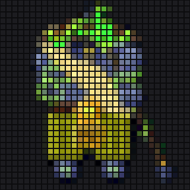
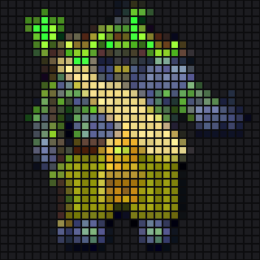
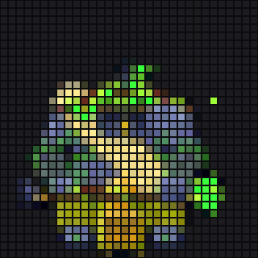
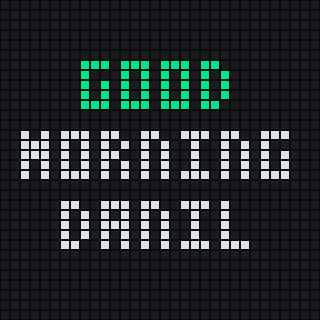

# kaolin-panel

My desk has a 10 EUR LED panel from Action. When Claude finishes a reply, Kaolin, my Earth Spirit avatar, spins his staff on it, with green light on both ends. I don't have to keep checking the app anymore. I just look at the desk.

| Claude finished | Claude needs my OK | Claude is working |
|---|---|---|
|  |  |  |

## How it works

```
Claude Code hook (Stop / Notification / UserPromptSubmit)
  -> hook.py: one UDP packet to 127.0.0.1:47474, returns instantly
  -> kaolin_daemon.py: started at login, keeps the Bluetooth link to the panel open
  -> panel: show_slot(n)
```

- **The panel** is a 32x32 "iPixel Color" display. Its USB cable only supplies power, so it sits on a phone charger on the desk, and the laptop talks to it over Bluetooth LE. I found it with a BLE scan (`LED_BLE_*`), then matched its GATT services (`fa02`/`fa03`) to the protocol the community reverse engineered ([pypixelcolor](https://github.com/lucagoc/pypixelcolor)).
- **The art** comes from Kaolin, my desktop pet. Its 64x64 sprite sheet already had a staff spin. `kaolin_frames.py` cuts the rows out, crops every animation to one shared box, scales them to 32x32 and pushes the jade glow to full LED green so the staff tips read from across the room. The sheet itself is not in this repo.
- **Speed.** The four animations are stored in the panel's own slots once. They survive power-off, and the daemon only re-uploads them when the GIFs change. After that, changing state is one tiny Bluetooth write (~30 ms) instead of a GIF upload (~8 s).
- **States:**
  - `done`: staff spin for 5 s, then calm idle
  - `waiting`: Grip cast when Claude asks for permission. The 60 s "waiting for input" reminder is ignored.
  - `working`: dim, Kaolin resting
  - After 20 min without anything new, the panel dims itself.
- **Robustness.** If the panel is unplugged, the daemon reconnects on its own within 30 s. If it's already running, a second copy exits (the UDP port is taken). If an upload doesn't get an ack, it retries.

## Set it up (Windows)

```powershell
python -m venv .venv
.venv\Scripts\pip install -r requirements.txt
copy config.example.toml config.toml        # set [panel] address (python morning.py scan)
.venv\Scripts\python kaolin_frames.py       # builds build\*.gif from the pet sheet
.venv\Scripts\pythonw kaolin_daemon.py      # or put a shortcut to this in shell:startup
```

Then add the hooks to `~/.claude/settings.json`:

```json
"hooks": {
  "Stop":             [{ "hooks": [{ "type": "command", "command": "python", "args": ["-I", "C:/path/hook.py", "done"],    "async": true, "timeout": 5 }] }],
  "UserPromptSubmit": [{ "hooks": [{ "type": "command", "command": "python", "args": ["-I", "C:/path/hook.py", "working"], "async": true, "timeout": 5 }] }],
  "Notification":     [{ "hooks": [{ "type": "command", "command": "python", "args": ["-I", "C:/path/hook.py", "waiting"], "async": true, "timeout": 5 }] }]
}
```

Test without Claude: `python hook.py done`. `python kaolin_daemon.py stop` frees the panel for the phone app, because it only takes one Bluetooth connection at a time.

## Side quest: morning board

The first idea was a bedside morning board: weather, routine steps and what to eat. It works (`python morning.py push`), but text at 32x32 is hard to read from bed, so Kaolin took the panel. Code is in `morning.py` + `pixels.py`.


