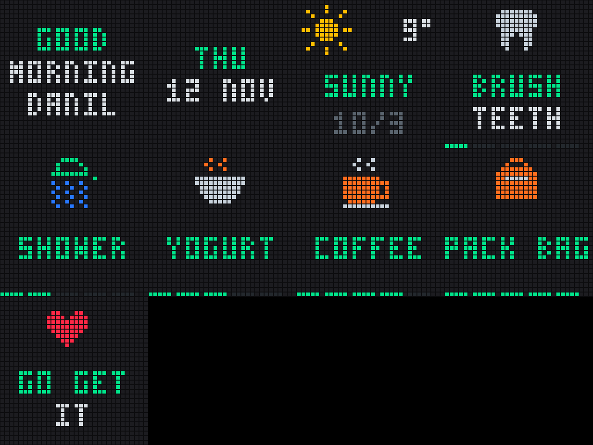

# pixel-morning

I bought a 32x32 LED pixel panel at Action for about 10 EUR. It only works with a phone app, and the USB cable only powers it, so my laptop couldn't see it. I didn't want another toy that needs the app, so I asked an AI coding agent (Claude Code) to find the panel and make it useful. One evening later it sits next to my bed and runs my morning.


## What it does

Every morning the panel plays a short loop:

1. **GOOD MORNING** + the date
2. **Weather** for my area (open-meteo, no API key): icon, temperature now, high/low, and **UMBRELLA** when rain is likely
3. **Today's one thing** (for example `TALK 11:00` on Friday), set per weekday
4. **The routine**, one card per step with a progress bar: teeth, shower, **what to eat** (rotates daily so I don't have to decide), coffee, pack bag. Weekends get a different list.
5. A sign-off

At night it turns into a dim clock. The panel also stores its own on/off times, so it goes dark at 00:30 and wakes at 06:55 even with no computer around.



## How the agent figured out the hardware

- Windows showed no new USB device, so the cable is power only.
- A Bluetooth LE scan found `LED_BLE_09A5AAEB`, the strongest signal in the room.
- Its GATT services (`fa02` write / `fa03` notify) match the **iPixel Color** protocol that the community has reverse engineered ([pypixelcolor](https://github.com/lucagoc/pypixelcolor), [protocol notes](https://github.com/cagcoach/ha-ipixel-color/blob/main/iPIXEL-Protocol-Documentation.md)).
- Reading the device info gave a 32x32 screen. A test message showed up on it, and that was enough to start building.

Everything on the board is drawn pixel by pixel: a hand-made 3x5 font (8 characters per line) and 12x12 icons, so it stays sharp instead of looking like a blurry, downscaled image.

## Run it

Windows, macOS or Linux with Bluetooth, Python 3.11+.

```bash
python -m venv .venv
.venv/Scripts/pip install -r requirements.txt     # macOS/Linux: .venv/bin/pip
cp config.example.toml config.toml                # edit routine, location, breakfasts
python morning.py scan        # finds the panel, put the address in config.toml
python morning.py preview     # renders preview/board_big.gif, no panel needed
python morning.py push        # sends today's board to the panel
python morning.py night       # dim clock
python morning.py schedule    # stores on/off times on the panel itself
python morning.py text "GM"   # quick message
```

Close the phone app first. The panel takes only one Bluetooth connection at a time.

### Automatic every morning (Windows)

`install_task.ps1` sets up two Task Scheduler jobs: `push` at 07:00 (it can wake the laptop) and `night` at 23:00.

```powershell
powershell -ExecutionPolicy Bypass -File install_task.ps1
```

## Limits

- The panel can't fetch anything by itself, so something with Bluetooth has to push the board. Here that's my laptop. An always-on version would be a ~5 EUR ESP32 next to the bed running the same commands.
- The panel's built-in schedule only switches power on and off. It can't change content.

## Files

- `morning.py`: the CLI, data (weather, routine) and the panel commands
- `pixels.py`: the 32x32 renderer (font, icons, card layouts, preview export)
- `config.example.toml`: copy it to `config.toml` and make it yours
